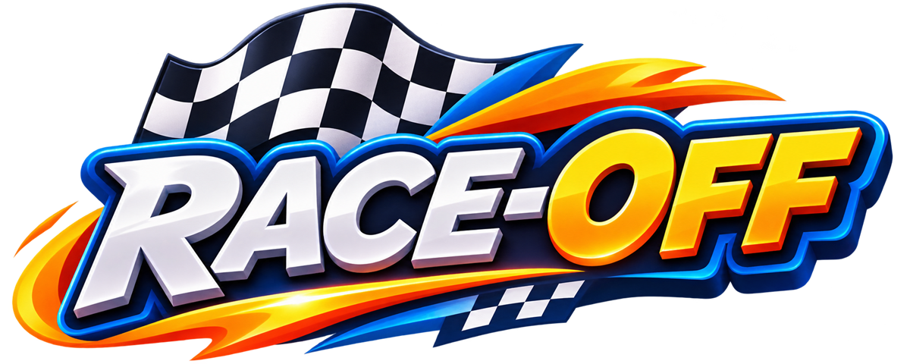
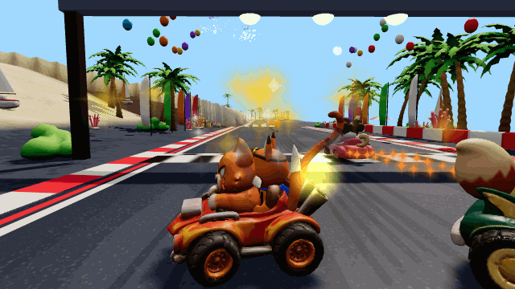
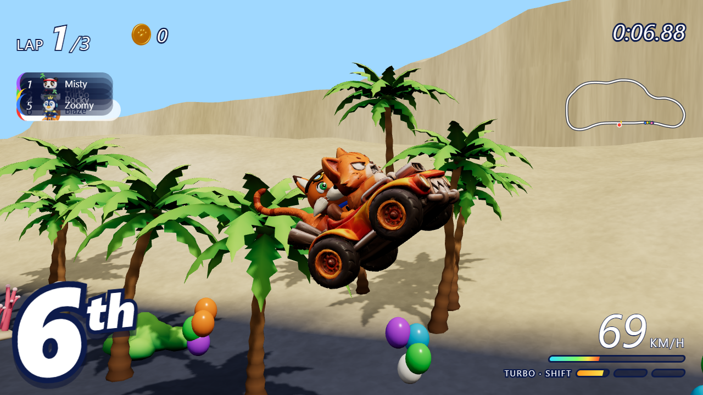
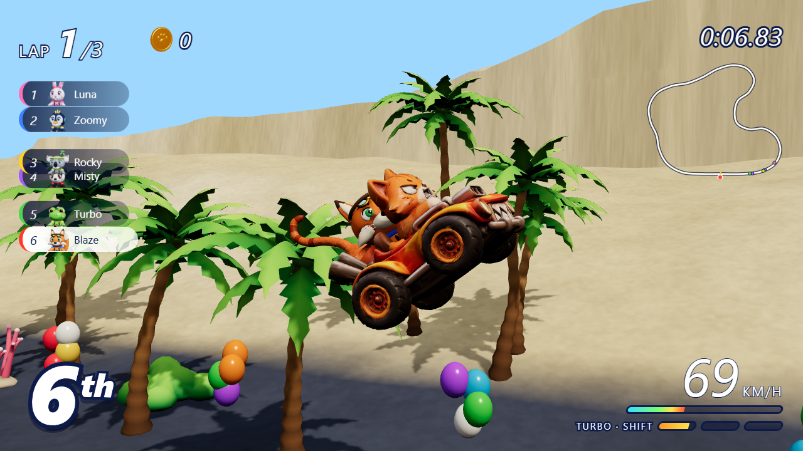
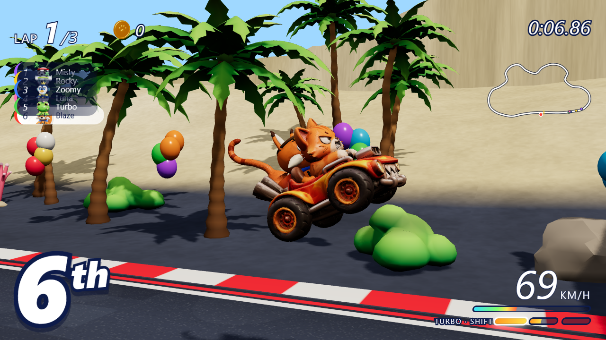
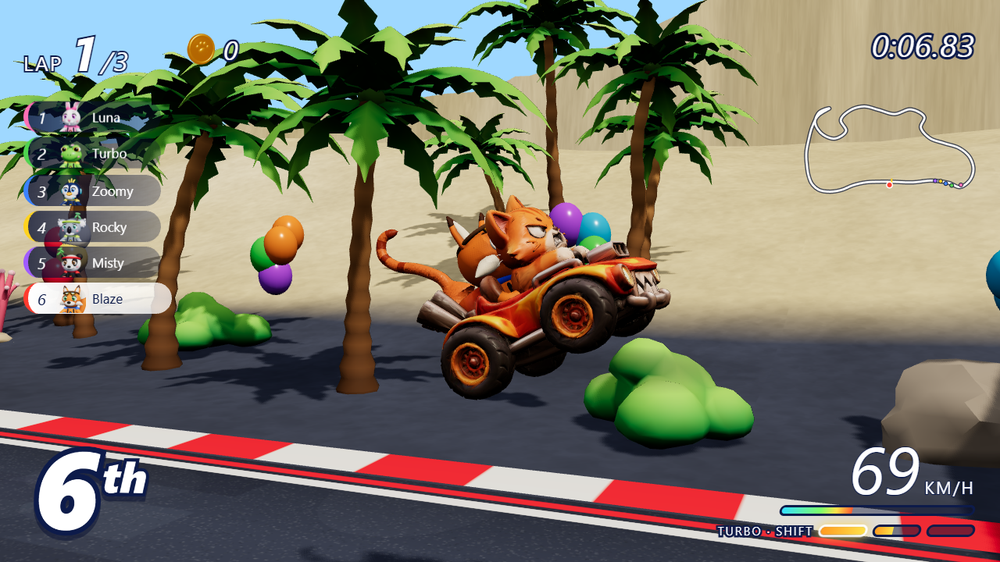
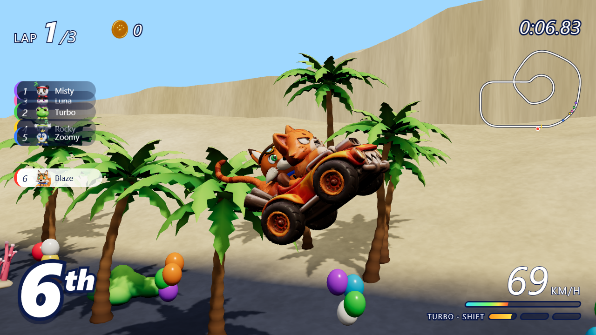
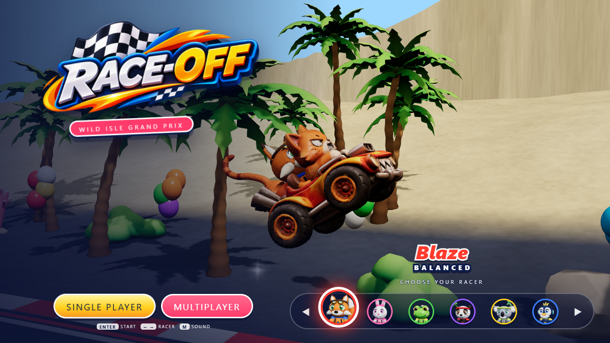
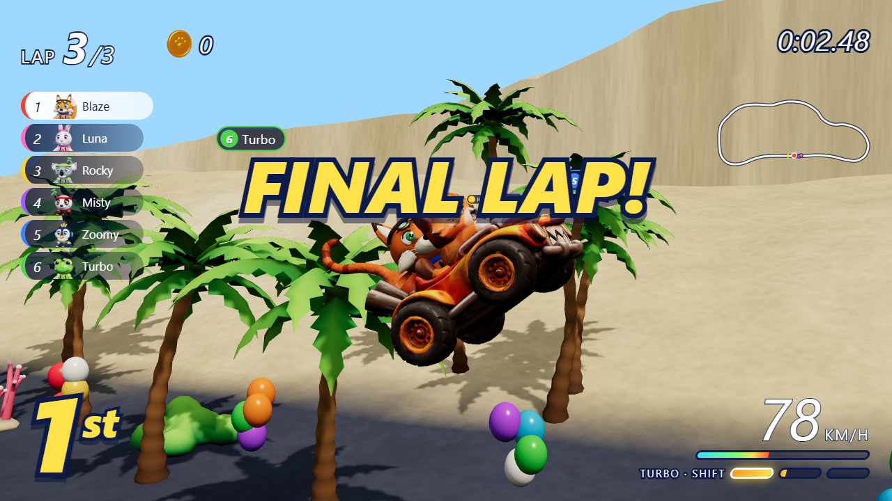
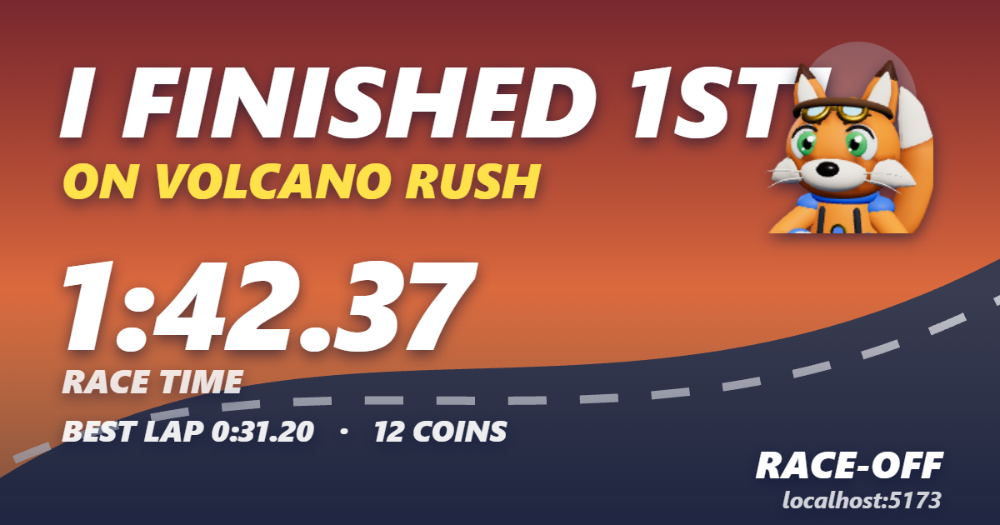

<div align="center">



# 🏁 Race-Off

**A free cartoon kart racing game that runs entirely in your browser.**
Drift, boost and battle six animal racers across four wild tracks — solo, in a
Grand Prix, or online with friends. No install, no account, just play.


**[▶ Play now](#-getting-started)** ·
[Features](#-features) ·
[Racers](#-meet-the-racers) ·
[Tracks](#-the-tracks) ·
[Controls](#-controls) ·
[Multiplayer](#-online-multiplayer)



*Live gameplay — weaving and power-drifting through Beach Blast.*

</div>

---

## ✨ Features

- 🏎️ **Six racers, six handling styles** — from the balanced Blaze to the
  breakneck Rocky. Every racer has their own grip/acceleration profile and a
  hand-modelled 3D kart.
- 🌀 **Real drifting** — hop, slide and charge a mini-turbo. Hold the drift
  through long corners and let it rip on exit.
- 🍄 **A full item game** — rockets, traps, shields, lightning bolts and speed
  mushrooms, with an on-screen roulette.
- 🏆 **Grand Prix mode** — race all six tracks back to back with points,
  or pick any single track for a quick 3-lap dash.
- 🏜️ **Six tracks** — beach, jungle, desert, volcano, snow and a sky finale,
  each with its own palette, hazards and scenery.
- ⏱️ **Time trial + ghost** — pick TIME TRIAL on the track picker for a
  clean, item-free lap against your own best: a translucent ghost kart
  replays your record lap in real time, and every personal best is saved
  per track (and becomes the ghost you race next time).
- 📲 **Installable PWA** — add Race-Off to your home screen / desktop and it
  runs fullscreen like an app; a service worker keeps it playable offline
  after the first visit.
- 🏁 **Speed classes & mirror mode** — 50cc / 100cc / 150cc on the track
  picker, plus a MIRROR toggle that flips every track's geometry for a
  whole new challenge. Your choice is remembered between sessions.
- 📅 **Daily challenge** — one seeded run per day: the date picks the track,
  engine class and mirror flag, and seeds the item roulette. Finish to copy
  a challenge link — friends open it and race your time. Streaks included.
- ⭐ **Champion liveries** — win a Grand Prix and your racer earns a spinning
  gold star and a badge on the picker, saved in your browser.
- 🌐 **Online multiplayer** — create a room, share a 4-character invite code
  (or a one-click invite link), and race up to 6 human players with live
  positions, emotes and host handover.
- 📱 **Plays everywhere** — keyboard, gamepad and touch controls, and a UI
  that adapts from ultrawide desktops down to portrait phones (audited at
  8 viewport sizes).
- 🔊 **Procedural audio** — engine, skids, items and a chiptune soundtrack
  synthesised live with WebAudio. No audio downloads. Karts around you get a
  doppler-shifted engine (higher on approach, lower as they pull away), the
  skid turns gravelly off the tarmac, and the countdown blips climb 3-2-1-GO.
- ⚡ **One codebase, no engine lock-in** — plain JavaScript + Three.js +
  Vite. Everything is small, readable modules you can actually edit.

## 🖼️ Screenshots

| | |
|---|---|
|  |  |
| *Beach Blast* | *Jungle Dash* |
|  |  |
| *Dune Drift* | *Frost Rush* |
|  |  |
| *Volcano Rush* | *Sky Sprint* |

|  |  |
|---|---|
| *Title screen & racer picker* | *Race results* |

## 🏁 Meet the racers

| Racer | Style | Kart colour | Handling |
|---|---|---|---|
| 🔦 **Blaze** the Fox | Balanced all-rounder | Red | grip 1.00 · accel 1.00 |
| 🐰 **Luna** the Rabbit | Cornering specialist | Pink | grip 1.16 · accel 0.94 |
| 🐢 **Turbo** the Turtle | Acceleration demon | Green | grip 0.94 · accel 1.10 |
| 🐼 **Misty** the Cat | Sure-footed gripper | Purple | grip 1.12 · accel 0.96 |
| 🦝 **Rocky** the Raccoon | Top-speed monster | Yellow | grip 0.90 · accel 1.14 |
| 🐧 **Zoomy** the Penguin | Smooth and steady | Blue | grip 1.06 · accel 1.00 |

## 🗺️ The tracks

| Track | Vibe | Hazard |
|---|---|---|
| 🏖️ **Beach Blast** | Sunny sands, palms and balloons | Sand traps off the racing line |
| 🌿 **Jungle Dash** | Vines, tiki totems and thick canopy | Slippery mud on the inside line |
| 🌋 **Volcano Rush** | Lava glow and ember skies | Erupting geysers near the summit |
| 🏜️ **Dune Drift** | Rolling dunes and a canyon trestle | A gap jump over the chasm, an oasis crossing |
| ❄️ **Frost Rush** | Icy esses and a frozen lake | Double crevasse crossings, low grip on the ice |
| ☁️ **Sky Sprint** | A floating finale above the clouds | Narrow sky-road with no rails |

## 🎮 Controls

| Action | Keyboard | Gamepad | Touch |
|---|---|---|---|
| Accelerate | `↑` / `W` | A / RT | auto |
| Brake / reverse | `↓` / `S` | B / LT | brake pedal |
| Steer | `←` `→` / `A` `D` | left stick / d-pad | steer pad |
| Hop / drift | `Space` / `Shift` | RB / X | drift button |
| Use item | `Enter` / `E` | LB / Y | item button |
| Mini-turbo | `Shift` | R3 | turbo button |
| Pause | `Esc` / `P` | Start | ⏸ |
| Mute | `M` | — | 🔊 |

## 🚀 Getting started

```bash
npm install        # once
npm run dev        # dev server on http://localhost:5173
npm run build      # production build into dist/
npm run preview    # serve the production build
```

Requires Node 18+. The game is pure static output — drop `dist/` on any
static host (GitHub Pages, Netlify, itch.io…) and it plays. Serve it over
**HTTPS** and the PWA kicks in automatically: browsers offer "Install
Race-Off", the app opens fullscreen, and previously downloaded tracks stay
available offline.

### One-command deploy

```powershell
.\tools\deploy.ps1 netlify   # or: vercel | surge | pages
```

Rebuilds `dist/` and ships it. Each target asks for a one-time interactive
login and remembers it. For GitHub Pages, push the repo and let
`.github/workflows/deploy.yml` deploy on every push (enable once under
Settings → Pages → Source: "GitHub Actions"). After deploying, verify the
live URL serves `/manifest.webmanifest`, `/sw.js` and `/og-image.jpg`.

### Optional companion server (public rooms + leaderboards)

```bash
node companion/server.mjs   # zero-dependency Node server on :8785
```

Adds public-room listing / quick match and per-track time-trial
leaderboards. Without it everything still works — rooms fall back to invite
codes and leaderboards keep a local top-10 in your browser. Point the game
at a hosted companion with `?dir=https://your-companion.example`.

## ⏱️ Time trial & your ghost

Pick **TIME TRIAL** on the track picker (it sits next to RACE above the
track list) for a solo, item-free run. Your best lap per track is stored in
your browser:

- A translucent **ghost kart** replays your record lap alongside you, so you
  always know whether you're ahead or behind your best pace.
- Beat your best and you'll see **NEW RECORD!** — from then on the ghost
  runs the *new* lap.
- Records are kept per track (`ro-ghost-<track>` in localStorage), so every
  track has its own target to chase.

Tip: racing a friend's local best? Records live in the browser profile, so
passing the keyboard around works — each profile keeps its own ghosts.

Every time-trial finish also submits your time to the **per-track
leaderboard** (top 10 per track and engine class) and shows the board right
in the results panel, with a **TOP N TIME!** toast when you crack it. With
the companion server running the board is shared by everyone; without it you
still get your own local top 10.

## 📸 Share cards

The results panel has a **SHARE RESULT** button that paints a 1200×630 card
— "I FINISHED 1ST! ON VOLCANO RUSH — 1:42.37", your racer's portrait, best
lap and coins — and hands it to the native share sheet on phones, or saves
`race-off.png` and copies the text on desktop. Post it, challenge someone.



## 🌐 Online multiplayer

Multiplayer is peer-to-peer over [PeerJS](https://peerjs.com) (WebRTC) —
no game server to run:

1. Pick **MULTIPLAYER** on the title screen and **create a room**.
2. Share the 4-character room code or hit **COPY INVITE LINK** and send it
   to a friend — opening the link joins the room automatically.
3. Anyone in the lobby can vote on the track; the host hits **START RACE**.

Up to 6 players race on a shared grid. Each client simulates its own kart and
broadcasts 20 snapshots/second; item events are relayed so everyone sees the
same rockets and traps. If the host disconnects, the next player is promoted
and the room re-hosts itself — the race goes on.

### Phase 3 — robust multiplayer

- **Emote wheel & chat pings** — tap the 💬 button (or keys **1–6**) to send
  👍 ❤️ 😂 😨 😡 🎉 above your kart; everyone sees them, rate-limited to one
  per 1.2s.
- **Spectator mode** — joining a room mid-race drops you into the live race
  as a spectator: every kart is relayed to you, the camera follows the field
  (cycle karts with ←/→), and you sit in the lobby for the next race
  automatically when it ends.
- **Adaptive interpolation** — the remote-kart buffer grows with measured
  jitter (`lag + 2×jitter`, clamped 60–400ms) so laggy players stay smooth
  without adding delay for everyone.
- **Room directory & quick match** — an optional tiny companion server
  (`node companion/server.mjs`, zero dependencies) keeps a live list of
  public rooms. Hosts can flip their room **PUBLIC** (listed, joinable via
  **QUICK MATCH**) or keep it invite-only; the directory also tells joining
  clients which room generation is live after a host migration, and a stale
  host entry is detected and ignored. Everything degrades gracefully when it
  is not running.
- **Grand Prix rooms survive reloads** — room cups persist points between
  races and every player follows the host to the next track automatically.

## 🛠️ Project layout

```
index.html              page shell + all UI markup
src/
  main.js               boot: build the Game, install the loop, start it
  core/
    Game.js             renderer, scene, lights, track loading, palettes, fitUI
    loop.js             the single rAF tick: input → physics → fx → hud → render
    raceFlow.js         menus→race plumbing: build the field, laps, results, cup
    CameraRig.js        title orbit, intro fly-through, chase cam, finish orbit
    Input.js            keyboard + gamepad + touch, merged into kart input
    assets.js           GLB/model/texture loading with progress
    utils.js            small shared helpers ($, clamp, damp, lerp, …)
  kart/
    KartModel.js        the six characters, their colours and tuning
    Kart.js             one racer: state, physics step, packing for the network
    Ghost.js            time-trial ghost: record/replay of your best lap
    physics.js          the driving model (drift, hop, walls, items, turbo)
    kartVisuals.js      per-frame cosmetic updates (wheels, drift marks, emotes)
  tracks/
    definitions.js      the four tracks: road curves, width, terrain, palettes
    Track.js            samples a definition into world-space geometry data
  world/
    Terrain.js          heightfield mesh around the road
    TrackMeshes.js      road, kerbs, walls, gantry, start lamps
    decor.js            trees, balloons, flags, fireworks stands, …
    materials.js        shared materials and palette application
  items/
    Items.js            roulette, pickups, rockets, traps, shields, bolts
  fx/
    FX.js               particles: dust, sparks, confetti, fireworks, splashes
  audio/
    AudioEngine.js      WebAudio synth for engine/skid/item sounds
    music.js            procedural chiptune loops per track
  ui/
    HUD.js              lap counter, positions, minimap, turbo, results screen
    Menus.js            title screen, racer picker, track/cup picker, lobby
    icons.js            renders the item/driver/trophy icons to data URLs
  net/
    Net.js              PeerJS transport: rooms, relay, keepalive, host handover
    directory.js        companion-directory client (public rooms, quick match)
    Multiplayer.js      lobby UI + wiring the transport into the game
  styles/game.css       all styling, responsive rules and HUD skin
tools/                  asset extraction + headless Playwright test scripts
docs/                   screenshots and GIFs used by this README
public/                 models, textures, music, fonts, logo, favicon,
                        PWA manifest + icons + service worker (sw.js)
```

### Where to make common edits

- **Add or change a track** — `src/tracks/definitions.js`. Each track is a
  list of control points plus width, terrain shaping and a colour palette.
- **Change a character's handling** — `CHAR_TUNING` in `src/kart/KartModel.js`.
- **Tweak the driving feel** — `src/kart/physics.js` (drift, hop, boost, walls).
- **Tune kart-vs-kart bumps** — `collideKarts()` at the bottom of
  `src/kart/physics.js`.
- **Add an item** — `src/items/Items.js` and the icon in `src/ui/icons.js`.
- **Tune the time-trial ghost** — recording rate, storage and replay live in
  `src/kart/Ghost.js`; record/save logic is in `raceFlow.js` (`onTTLap`).
- **Change HUD layout** — markup in `index.html`, styles in
  `src/styles/game.css`, logic in `src/ui/HUD.js`.
- **Adapt the UI to other screens** — `fitUI()` in `src/core/Game.js`
  computes the `--ts/--tss`, `--hs`, `--rs` and `--rowh` CSS variables that
  all responsive scaling hangs off.
- **Swap the logo or favicon** — drop a new `public/logo-raceoff.png` or
  `public/favicon.png` (square works best for favicons). Then regenerate the
  PWA icons and share card with `powershell -File tools/make_pwa_assets.ps1`.

## 🧪 Tests

Headless smoke and gameplay tests drive the real game with
[Playwright](https://playwright.dev) (software WebGL) and a fixed clock, so
races are deterministic:

```bash
node tools/smoke.mjs          # boots the title screen
node tools/test_race.mjs      # full race: intro, laps, finish, results
node tools/test_all_tracks.mjs
node tools/test_finish.mjs    # finishing awards positions + results panel
node tools/test_gp.mjs        # grand prix flow
node tools/test_pause.mjs     # pause / restart
node tools/test_steer.mjs     # left = left, right = right
node tools/test_collide.mjs   # kart-vs-kart separation and bump events
node tools/test_timetrial.mjs # time trial: no items, ghost record/replay, results
node tools/test_ghost.mjs     # ghost kart interpolates the saved best lap
node tools/test_feel.mjs      # audio feel: doppler, surface skid, countdown blips
node tools/test_new_tracks.mjs# desert + snow: build, contents, AI laps them
node tools/test_class_mirror.mjs # 50/100/150cc speeds + mirrored geometry + AI laps
node tools/test_daily.mjs     # daily challenge: seed, one attempt, share hash
node tools/test_unlocks.mjs   # GP win -> champion livery + picker badge
node tools/test_pwa.mjs       # manifest, icons, service worker (preview build)
node tools/test_share.mjs     # results share card: canvas render + download
node tools/test_scores.mjs    # leaderboards: companion roundtrip + offline board
node tools/test_spacing.mjs   # 600-frame race, asserts no kart overlap
node tools/test_mp.mjs        # host + guest in two pages
node tools/test_interp.mjs    # snapshot interpolation + adaptive jitter buffer
node tools/test_emotes.mjs    # emote wheel: relay, self-show, rate limit
node tools/test_spectate.mjs  # late joiner spectates, then races the next one
node tools/test_directory.mjs # companion directory: list, quick match, migration
node tools/audit_ui.mjs       # UI overlap/offscreen audit, 8 viewports x 5 screens
```

`tools/capture_shots.mjs` and `tools/make_gif.mjs` regenerate the media in
`docs/` for this README.

## 🔍 About

Race-Off is a browser-based cartoon racing game built with Three.js and Vite —
a love letter to couch-multiplayer kart racers, playable on anything with a
browser. Models, textures and music were extracted from the original game
bundle in `pretty/game.pretty.js` (reference only — not needed to run it).

Keywords: kart racing game, browser game, HTML5 game, cartoon racing,
multiplayer racing game, drift game, Grand Prix, Three.js game, free racing#
